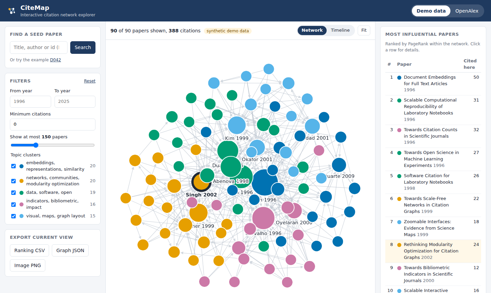
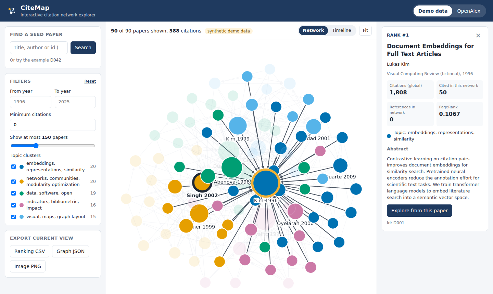
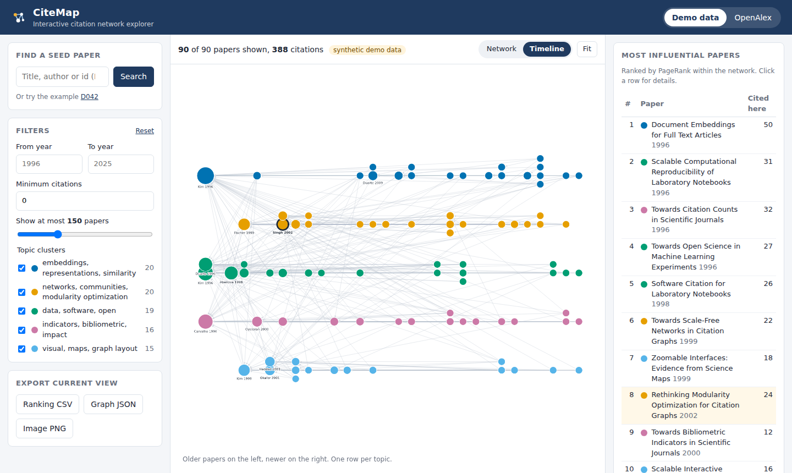

# CiteMap

[](https://github.com/verozroke/citemap-app/actions/workflows/ci.yml)
check
check2
CiteMap is an interactive citation network explorer. You start from one paper
(the _seed_). CiteMap collects the papers it cites and the papers that cite it,
ranks them by influence with PageRank, groups them into topic clusters and
draws the result as a graph you can filter, inspect and export.

This repository holds the web application: a FastAPI backend and a React
frontend. Graph construction, ranking and export come from the separately
published library [citemap-core](https://github.com/verozroke/citemap-core).



## Features

- **Two data sources.** A bundled _synthetic_ demo dataset that works offline,
  and live data from [OpenAlex](https://openalex.org) (search by title words,
  DOI or OpenAlex id).
- **Influence ranking.** PageRank over the local citation graph, plus local and
  global citation counts for every paper.
- **Topic clusters.** TF-IDF vectors of titles and abstracts grouped with
  k-means; each cluster gets a label from its most characteristic terms.
- **Interactive graph.** Cytoscape.js with a force-directed layout and a
  timeline layout (year on the horizontal axis, one row per topic). Click a
  paper to see its details and highlight its neighbours, then continue the
  exploration from it.
- **Filters.** Year range, minimum citations, topic clusters and a maximum
  number of papers (the most influential papers are kept first).
- **Export.** Ranking as CSV, the current graph as JSON, the picture as PNG.
- **Shareable views.** The source and seed paper are kept in the address bar.

| Paper details                                        | Timeline layout                            |
| ---------------------------------------------------- | ------------------------------------------ |
|  |  |

## Quick start with Docker

```bash
docker compose up --build
```

Open <http://localhost:8000>. The demo dataset works immediately; OpenAlex
needs internet access. Cached networks are kept in the `citemap-data` volume.

## Local development

Requirements: Python 3.10 or newer, Node.js 22 or newer, Git.

**Backend** (terminal 1):

```bash
cd backend
python -m venv .venv
# Windows: .venv\Scripts\activate    macOS/Linux: source .venv/bin/activate
pip install -e ".[dev]"
citemap-api                      # http://127.0.0.1:8000, API docs at /docs
```

**Frontend** (terminal 2):

```bash
cd frontend
npm install
npm run dev                      # http://localhost:5173, proxies /api to :8000
```

To run everything from one server instead, build the frontend once
(`npm run build` in `frontend/`) and start `citemap-api`: it serves
`frontend/dist` at <http://127.0.0.1:8000>.

## Configuration

All settings are environment variables and all are optional.

| Variable                       | Default                  | Meaning                                                       |
| ------------------------------ | ------------------------ | ------------------------------------------------------------- |
| `OPENALEX_API_KEY`             | none                     | OpenAlex API key; gives a larger daily request budget         |
| `OPENALEX_MAILTO`              | none                     | Contact e-mail sent to OpenAlex                               |
| `CITEMAP_MAX_CITING`           | `50`                     | How many citing papers to fetch for a live network (1 to 100) |
| `CITEMAP_CACHE_TTL_HOURS`      | `168`                    | How long a live network stays in the cache                    |
| `CITEMAP_DATA_DIR`             | `.citemap-data`          | Folder of the SQLite cache                                    |
| `CITEMAP_STATIC_DIR`           | `frontend/dist` if built | Built frontend to serve at `/`                                |
| `CITEMAP_CORS_ORIGINS`         | `http://localhost:5173`  | Comma-separated origins allowed to call the API               |
| `CITEMAP_HOST`, `CITEMAP_PORT` | `127.0.0.1`, `8000`      | Address of the server                                         |

## HTTP API

Interactive documentation is generated at `/docs` (Swagger UI).

| Method and path                                  | Purpose                                                                              |
| ------------------------------------------------ | ------------------------------------------------------------------------------------ |
| `GET /api/health`                                | Liveness check and version                                                           |
| `GET /api/sources`                               | Available data sources with an example id                                            |
| `GET /api/search?source=&q=&limit=`              | Find seed papers                                                                     |
| `POST /api/graphs`                               | Start building a graph: `{"source", "seed_id", "refresh"}`; returns a job (202)      |
| `GET /api/jobs/{id}`                             | Job status: `queued`, `running`, `done` or `failed`                                  |
| `GET /api/graphs/{source}/{seed_id}`             | Analysed graph; filters `from_year`, `to_year`, `min_citations`, `clusters`, `limit` |
| `GET /api/graphs/{source}/{seed_id}/export.csv`  | Ranking as CSV (same filters)                                                        |
| `GET /api/graphs/{source}/{seed_id}/export.json` | Graph as JSON (same filters)                                                         |

Errors use the status code and a `detail` message: 400 for malformed input,
404 for unknown sources, papers or jobs, 502 when OpenAlex fails.

## Architecture

```
React + Cytoscape.js  ──HTTP/JSON──▶  FastAPI routes
                                          │
                        JobRunner (thread pool, job status in SQLite)
                                          │
              DataSource port ─┬─ DemoSource (bundled synthetic data)
                               └─ OpenAlexSource ─▶ citemap-core OpenAlexProvider
                                          │
          analysis.enrich: citemap-core graph + PageRank + summary, TF-IDF/k-means clusters
                                          │
                   Repository (SQLite): cached analysed networks and jobs
```

The design follows the architecture adjustments proposed in Assignment 2:

| Adjustment                                        | Where it is implemented                                                     |
| ------------------------------------------------- | --------------------------------------------------------------------------- |
| A1 Ports and adapters for data sources            | `DataSource` protocol with `DemoSource` and `OpenAlexSource` (`sources.py`) |
| A2 Background jobs with a status endpoint         | `JobRunner` (`jobs.py`), `POST /api/graphs` and `GET /api/jobs/{id}`        |
| A3 Repository over the database                   | `Repository` (`repository.py`) holds all SQL                                |
| A4 Limit on the number of displayed nodes         | `build_view` keeps the seed and the highest ranked papers (`analysis.py`)   |
| A5 Cache the assembled network, not only raw data | `enrich` result stored once, views only filter it                           |

## Project structure

```
backend/
  src/citemap_api/     FastAPI app, data sources, analysis, clustering, storage
  src/citemap_api/data demo_network.json (synthetic, generated)
  scripts/             generate_demo_data.py (reproducible generator, seed 42)
  tests/               pytest suite (no network access needed)
frontend/
  src/                 React components, API client, graph helpers
  src/**/*.test.ts(x)  Vitest and Testing Library tests
docs/screenshots/      images used in this README
Dockerfile             multi-stage build: test targets, frontend, wheels, runtime
Jenkinsfile            Jenkins pipeline: tests, image, smoke test, push, staging
ci/                    the pipeline steps as scripts (also run by GitHub Actions)
jenkins/               local Jenkins controller configured as code
.github/workflows/     CI: lint, type check, tests, build, Docker smoke test
```

## Quality checks

```bash
cd backend  && ruff check . && ruff format --check . && mypy && pytest --cov
cd frontend && npm run lint && npm run typecheck && npm test && npm run build
```

The backend test suite replaces OpenAlex with an in-memory fake, so it runs
offline; coverage must stay at or above 85 %.

## CI/CD with Jenkins

The [`Jenkinsfile`](Jenkinsfile) defines the delivery pipeline. Each stage calls a
script in [`ci/`](ci/), and all work happens in Docker containers, so the only
requirement on the Jenkins machine is a Docker engine.

| Stage                | Script                 | What it does                                                                         |
| -------------------- | ---------------------- | ------------------------------------------------------------------------------------ |
| Checkout             |                        | Gets the commit and names the image `citemap-app:<build>-<commit>`                   |
| Unit tests: Backend  | `ci/test-backend.sh`   | ruff, mypy and pytest in the `backend-test` image; JUnit and coverage reports        |
| Unit tests: Frontend | `ci/test-frontend.sh`  | oxlint, tsc and Vitest in the `frontend-test` image; JUnit report                    |
| Build image          | `ci/build-image.sh`    | Builds the `runtime` image with the commit as a label                                |
| Smoke test           | `ci/smoke-test.sh`     | Starts the image and checks health, the UI, a demo graph and CSV export              |
| Push to Docker Hub   | `ci/push-image.sh`     | Optional, parameter `PUSH_IMAGE`                                                     |
| Deploy to staging    | `ci/deploy-staging.sh` | Replaces the `citemap-staging` container on port 8081; rolls back if the check fails |

The job polls GitHub every two minutes, so every commit to `main` is built.
[`jenkins/`](jenkins/) contains a ready Jenkins controller: `docker compose up -d --build`
in that folder starts Jenkins at <http://localhost:8080> with the job already
created (see [`jenkins/README.md`](jenkins/README.md)). Without Jenkins, the same
pipeline runs with:

```bash
bash ci/run-local.sh            # tests, image, smoke test
bash ci/run-local.sh --deploy   # and deploy to http://localhost:8081
```

## About the demo dataset

`backend/src/citemap_api/data/demo_network.json` is **synthetic**: 100
invented papers in five research topics with generated titles, authors,
venues, abstracts and citations. It exists so that the application can be
demonstrated without internet access and with predictable results. It does not
describe real publications. Regenerate it with
`python backend/scripts/generate_demo_data.py`.

## License

MIT, see [LICENSE](LICENSE). Data retrieved from OpenAlex is available under CC0.
